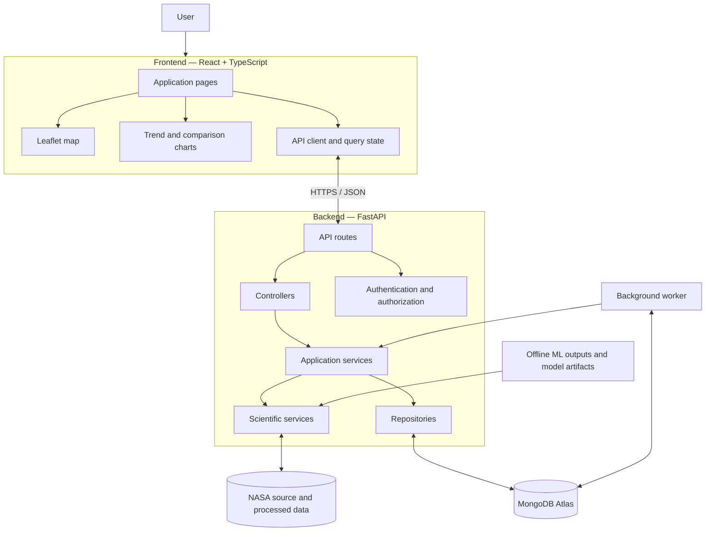
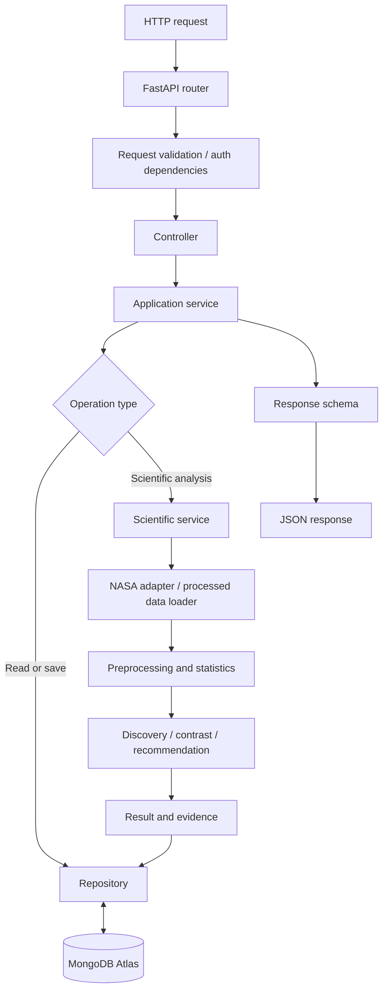
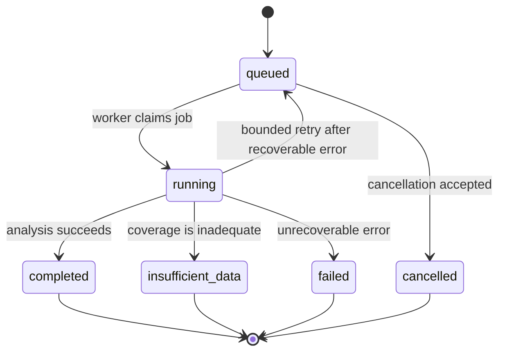
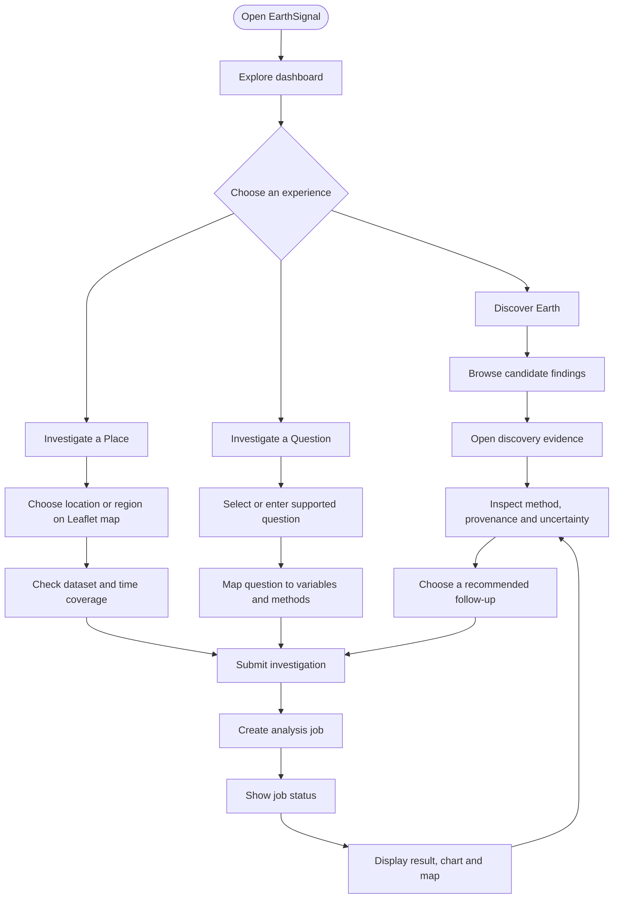
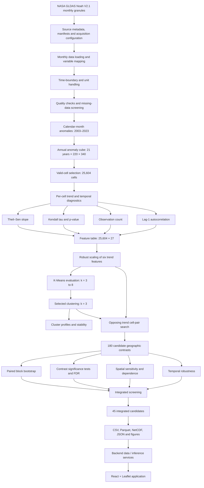
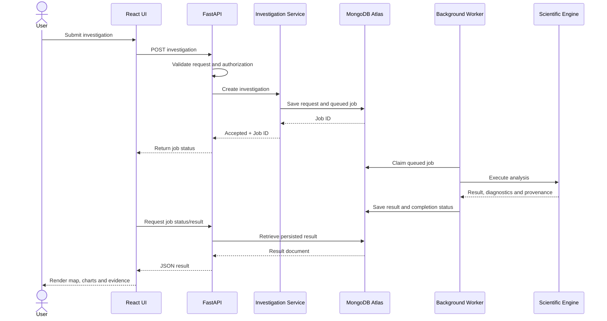

# EarthSignal

### NASA Earth observation → environmental trend analysis → geographic discovery

EarthSignal is a geospatial environmental investigation platform
designed around NASA Earth-observation and land-surface data. It
combines a React + TypeScript web interface, a modular Python/FastAPI
backend, MongoDB Atlas persistence, and an offline scientific/ML
workflow.

The project is designed to help users explore environmental trends,
compare geographic patterns, inspect the evidence behind a result, and
launch follow-up investigations.

> **Project status note:** The ML results documented here are based on
> the executed GLDAS Noah V2.1 workflow described below. The broader
> application architecture describes the intended integrated product. Do
> not assume that every planned dataset adapter, API route,
> authentication flow, database integration, worker, or recommendation
> workflow is production-verified merely because it appears in this
> README. Confirm the current implementation using the repository tests
> and the final end-to-end checklist.

------------------------------------------------------------------------

## Contents

-   [1. Project overview](#1-project-overview)
-   [2. What EarthSignal does](#2-what-earthsignal-does)
-   [3. Technology stack](#3-technology-stack)
-   [4. System architecture](#4-system-architecture)
-   [5. Repository structure](#5-repository-structure)
-   [6. Requirements](#6-requirements)
-   [7. Local setup](#7-local-setup)
    -   [7.1 Clone and inspect](#71-clone-and-inspect)
    -   [7.2 Backend setup on Windows](#72-backend-setup-on-windows)
    -   [7.3 Backend setup on
        macOS/Linux](#73-backend-setup-on-macoslinux)
    -   [7.4 Environment configuration](#74-environment-configuration)
    -   [7.5 Frontend setup](#75-frontend-setup)
    -   [7.6 Start the application](#76-start-the-application)
    -   [7.7 Start the background
        worker](#77-start-the-background-worker)
-   [8. Application user flow](#8-application-user-flow)
-   [9. ML and scientific pipeline](#9-ml-and-scientific-pipeline)
-   [10. ML results currently
    produced](#10-ml-results-currently-produced)
-   [11. Backend request lifecycle](#11-backend-request-lifecycle)
-   [12. API and service design](#12-api-and-service-design)
-   [13. Data storage and artifacts](#13-data-storage-and-artifacts)
-   [14. Maps and basemaps](#14-maps-and-basemaps)
-   [15. Testing and verification](#15-testing-and-verification)
-   [16. Scientific interpretation and
    limitations](#16-scientific-interpretation-and-limitations)
-   [17. Troubleshooting](#17-troubleshooting)
-   [18. Security and deployment
    notes](#18-security-and-deployment-notes)
-   [19. Current scope and future
    extensions](#19-current-scope-and-future-extensions)

------------------------------------------------------------------------

## 1. Project overview

EarthSignal focuses on a practical question:

**Can long-term NASA Earth-system datasets reveal geographically
contrasting environmental trends, and can those patterns be explored
through an accessible web application?**

The platform is organized into four connected layers:

1.  **Data layer** --- NASA source files, metadata, provenance
    manifests, and processed scientific datasets.
2.  **Scientific layer** --- preprocessing, trend estimation,
    autocorrelation diagnostics, clustering, contrast discovery, and
    validation.
3.  **Application layer** --- FastAPI services, database repositories,
    background processing, and API endpoints.
4.  **Presentation layer** --- React + TypeScript pages, interactive
    Leaflet maps, charts, and evidence views.

The ML workflow is run separately from the live web server. The backend
should load approved outputs or model artifacts for serving; it should
not retrain the full research pipeline on every web request.

## 2. What EarthSignal does

The product is organized around three investigation experiences.

### Discover Earth

Users browse candidate environmental findings produced by the scientific
screening workflow. A discovery should expose its variable, time period,
geographic coordinates, trend direction, magnitude, uncertainty or
significance evidence where available, source dataset, and methodology.

### Investigate a Place

Users select a supported location or region on the map. The application
checks dataset and temporal coverage, retrieves or loads the relevant
time series, runs the supported statistical workflow, and presents the
result.

### Investigate a Question

Users select or enter a supported environmental question. The
application maps it to available variables and methods, checks whether
the required data exist, and launches an investigation. Unsupported
questions must be reported as unsupported or insufficient-data
cases---not presented as completed scientific analyses.

These experiences should reuse the same scientific services and data
definitions rather than implementing separate, inconsistent
calculations.

## 3. Technology stack

  -----------------------------------------------------------------------
  Layer                   Technology              Responsibility
  ----------------------- ----------------------- -----------------------
  Frontend                React, TypeScript, Vite User interface and
                                                  client routing

  Styling                 Tailwind CSS (if        Layout and visual
                          present in the current  design
                          frontend)               

  Maps                    Leaflet / React-Leaflet Geographic exploration
                                                  and markers

  Charts                  Existing chart library  Trend and comparison
                          in the frontend         visualization

  API                     Python, FastAPI,        HTTP API and
                          Uvicorn                 application
                                                  orchestration

  Validation              Pydantic                Request and response
                                                  validation

  Database                MongoDB Atlas, PyMongo  Users, investigations,
                                                  jobs, metadata and
                                                  saved results

  Scientific data         xarray, NumPy, pandas,  NetCDF processing and
                          SciPy and related       analysis
                          packages                

  ML                      scikit-learn            Robust scaling and
                                                  K-Means clustering in
                                                  the executed pipeline

  Research runtime        Google Colab            Offline data
                                                  preparation, ML
                                                  execution and
                                                  validation

  Mapping data            NASA-derived geographic Scientific layers and
                          outputs                 discovery locations
  -----------------------------------------------------------------------

**No Docker is required or used in the intended setup.** Run Python,
Node.js and the worker directly in native local environments.

## 4. System architecture

### 4.1 High-level architecture



### 4.2 Backend architecture

The backend follows a layered design. Keep HTTP handling, application
logic, scientific computation, and database operations separate.



Expected responsibilities:

-   **Routes:** endpoint definitions, dependency injection,
    authentication requirements, and HTTP status codes.
-   **Controllers:** coordinate the incoming request and outgoing
    response.
-   **Services:** reusable application workflows and orchestration.
-   **Repositories:** MongoDB reads/writes; no scientific calculations.
-   **Models/schemas:** validated request, response, and
    persisted-document structures.
-   **NASA adapters:** product-specific metadata and data access.
-   **Processing:** coordinate/time handling, quality control, unit
    conversion, and aggregation.
-   **Statistics:** trend estimates, confidence intervals,
    autocorrelation and multiple-testing procedures.
-   **Discovery:** screening, ranking, contrast generation, and
    provenance.
-   **Recommendations:** explainable follow-up suggestions linked to
    executable investigations.
-   **ML inference:** load versioned artifacts and validate feature
    inputs; do not train models during API requests.
-   **Workers:** execute long-running jobs outside the request/response
    process.

### 4.3 Background job lifecycle

Long-running investigations should be queued and processed by a separate
native Python worker.



Use atomic job claiming, bounded retries, execution timeouts,
leases/heartbeats, stale-job recovery, and idempotency where supported.
A job must not be retried forever.

## 5. Repository structure

The exact repository may differ. This is the intended organization;
retain the actual working paths in the project rather than moving files
solely to match this diagram.

``` text
EarthSignal/
├── backend/
│   ├── app/
│   │   ├── main.py
│   │   ├── core/
│   │   ├── db/
│   │   │   ├── db.py
│   │   │   └── indexes.py
│   │   ├── models/
│   │   ├── routes/
│   │   ├── controllers/
│   │   ├── services/
│   │   ├── repositories/
│   │   ├── nasa_adapters/
│   │   ├── processing/
│   │   ├── statistics/
│   │   ├── discovery/
│   │   ├── recommendations/
│   │   ├── ml_inference/
│   │   └── workers/
│   ├── tests/
│   ├── requirements.txt
│   └── .env.example
│
├── frontend/
│   ├── src/
│   │   ├── app/
│   │   ├── pages/
│   │   ├── components/
│   │   ├── maps/
│   │   ├── charts/
│   │   ├── hooks/
│   │   ├── services/
│   │   └── types/
│   └── package.json
│
├── ml_training/
│   ├── notebooks/
│   ├── src/
│   ├── configs/
│   └── README.md
│
├── model_artifacts/
├── data/
│   ├── raw/
│   ├── processed/
│   ├── sample/
│   └── manifests/
├── scripts/
│   ├── windows/
│   └── unix/
├── docs/
│   ├── architecture.md
│   ├── datasets.md
│   ├── methodology.md
│   ├── implementation-status.md
│   ├── testing.md
│   ├── known-issues.md
│   └── deployment.md
├── .env.example
├── .gitignore
├── README.md
└── LICENSE
```

## 6. Requirements

Install these locally:

-   **Python:** use Python 3.11 or 3.12, subject to the versions
    supported by the pinned backend dependencies. Avoid Python 3.14 for
    this project until all scientific packages have compatible wheels.
-   **Node.js:** use a current Node.js LTS release compatible with the
    frontend lockfile.
-   **Git**
-   **MongoDB Atlas account** for live persistence, if the current
    application requires it.
-   **NASA Earthdata Login** only for adapters/products that require
    authenticated access.
-   A modern browser.

Check installed versions:

``` powershell
python --version
py --list
node --version
npm --version
git --version
```

On Windows, if `py -3.11` or `py -3.12` reports that no runtime is
installed, install a supported Python version first. Do not create the
virtual environment using an unsupported Python installation.

## 7. Local setup

### 7.1 Clone and inspect

``` bash
git clone <YOUR_REPOSITORY_URL>
cd <YOUR_REPOSITORY_DIRECTORY>
```

Before installing packages, inspect the actual repository:

``` text
backend/requirements.txt
frontend/package.json
frontend/package-lock.json
.env.example
backend/.env.example
```

Use the dependency manifests and lockfiles committed with the project.
Do not install arbitrary latest versions over pinned dependencies.

### 7.2 Backend setup on Windows

Open PowerShell in the repository root.

If Python 3.11 or 3.12 is installed and registered with the Python
launcher:

``` powershell
py -3.12 -m venv backend\.venv
```

If the installed interpreter is available only as `python`, use its
verified executable:

``` powershell
python -m venv backend\.venv
```

Activate the environment:

``` powershell
.\backend\.venv\Scripts\Activate.ps1
```

If PowerShell blocks activation because of the execution policy, use a
process-scoped policy for the current terminal:

``` powershell
Set-ExecutionPolicy -Scope Process -ExecutionPolicy Bypass
.\backend\.venv\Scripts\Activate.ps1
```

Alternatively, avoid activation and call the virtual environment's
Python directly.

Install the backend's pinned requirements:

``` powershell
python -m pip install --upgrade pip setuptools wheel
python -m pip install -r backend\requirements.txt
```

If the repository uses a different requirements-file path, use the
actual path. Do not report setup as successful if pip ends with a
package metadata or installation error.

### 7.3 Backend setup on macOS/Linux

From the repository root:

``` bash
python3.12 -m venv backend/.venv
source backend/.venv/bin/activate
python -m pip install --upgrade pip setuptools wheel
python -m pip install -r backend/requirements.txt
```

If Python 3.12 is not installed, install a version supported by the
project's pinned packages and use that interpreter to create the
environment.

### 7.4 Environment configuration

Copy the example environment file and fill in the values locally:

**Windows:**

``` powershell
Copy-Item .env.example .env
```

**macOS/Linux:**

``` bash
cp .env.example .env
```

If the backend has its own example file, configure `backend/.env` as
well.

Typical settings may include:

``` dotenv
# Application
APP_ENV=development
API_HOST=127.0.0.1
API_PORT=8000
FRONTEND_ORIGIN=http://localhost:5173

# MongoDB Atlas
MONGODB_URI=
MONGODB_DATABASE=earthsignal

# Authentication — use a long, random secret
JWT_SECRET=
JWT_ALGORITHM=HS256
ACCESS_TOKEN_EXPIRE_MINUTES=30

# NASA Earthdata — only if required by the configured adapter
NASA_EARTHDATA_USERNAME=
NASA_EARTHDATA_PASSWORD=

# Data and model paths
DATA_ROOT=
MODEL_ARTIFACTS_DIR=
```

**Important:** These are illustrative configuration names, not a
guarantee that the current code reads these exact variables. Open the
backend settings/configuration module and `.env.example`; use the exact
variable names defined by the implementation. Never commit `.env`,
passwords, tokens, private keys, or MongoDB connection strings.

For MongoDB Atlas:

1.  Create or select a cluster.
2.  Create a database user.
3.  Configure network access for your development IP.
4.  Copy the driver connection string.
5.  Put it in the environment variable actually used by `app/db/db.py`.
6.  Start the backend and verify its database health check, if
    implemented.

Do not expose Atlas credentials in frontend variables. Browser-exposed
variables are public.

### 7.5 Frontend setup

Open a second terminal:

``` bash
cd frontend
npm ci
```

If the project does not contain a lockfile, use:

``` bash
npm install
```

Configure the frontend API base URL in the environment file expected by
Vite, commonly:

``` dotenv
VITE_API_BASE_URL=http://127.0.0.1:8000
```

Use the exact variable referenced by the frontend source code. Restart
Vite after changing environment variables.

### 7.6 Start the application

**Terminal 1 --- backend**

From the repository root, activate the backend environment and run the
actual FastAPI entry point. A typical command is:

``` bash
uvicorn app.main:app --reload --app-dir backend
```

If the Python package is launched from the backend directory instead:

``` bash
cd backend
uvicorn app.main:app --reload
```

Use whichever import path matches the actual repository. Confirm the
startup output shows that the application is listening.

Check:

-   `http://127.0.0.1:8000/` if a root route exists
-   `http://127.0.0.1:8000/docs` for FastAPI Swagger UI
-   `http://127.0.0.1:8000/api/health` if that health endpoint exists

**Terminal 2 --- frontend**

``` bash
cd frontend
npm run dev
```

Open the local URL printed by Vite, commonly `http://localhost:5173`.

### 7.7 Start the background worker

If the repository includes a MongoDB-backed worker, run it in a third
terminal using the same backend virtual environment.

A project script may be available:

``` powershell
.\scripts\run_worker.ps1
```

Or use the actual worker module:

``` bash
python -m app.workers.worker
```

The exact command depends on the implemented module path. Confirm it
from the script and worker source before running it.

The worker is needed only for features that submit background jobs. Do
not start multiple workers unless the job-claiming design supports that
safely.

------------------------------------------------------------------------

## 8. Application user flow

The intended end-to-end experience is:



### Suggested user test

1.  Open the dashboard.
2.  Open a discovery.
3.  Check the variable, time range, units and source.
4.  Open its geographic location on the map.
5.  Start a place-based investigation for a supported region.
6.  Wait for the job to finish.
7.  Inspect the trend chart and evidence.
8.  Run a supported follow-up question.
9.  Compare two compatible geographic regions.
10. Save the investigation if login and persistence are enabled.

A successful UI click is not proof of a successful scientific analysis.
Confirm the API response and persisted result.

## 9. ML and scientific pipeline

### 9.1 Executed GLDAS workflow

The completed research workflow uses **NASA GLDAS Noah V2.1**, product
identifier `GLDAS_NOAH025_M`, over the regional study grid for January
2003--December 2023.

The annual anomaly dataset contains:

-   21 annual observations
-   220 × 340 latitude--longitude grid
-   25,604 valid geographic cells
-   Six environmental variables

Variables used:

  EarthSignal variable            GLDAS field / description
  ------------------------------- ------------------------------
  `air_temperature_c`             Near-surface air temperature
  `surface_temperature_c`         Surface skin temperature
  `precipitation_mm_month`        Precipitation
  `evapotranspiration_mm_month`   Evapotranspiration
  `topsoil_water_kg_m2`           `SoilMoi0_10cm_inst`
  `rootzone_water_kg_m2`          `RootMoist_inst`

### 9.2 ML pipeline diagram



### 9.3 Preprocessing

The monthly GLDAS fields were converted into EarthSignal variable names.
Calendar-month boundaries were reconstructed for month-duration
handling, and monthly anomalies were calculated against the 2003--2023
baseline.

The pipeline preserved and flagged negative evapotranspiration values
rather than silently deleting them.

A January 2023 source check showed that the converted topsoil and
root-zone variables matched their corresponding original NASA fields for
all 25,604 finite cells, with matching missing masks. This is a
documented spot-check, not proof that every monthly source file has been
independently audited.

### 9.4 Feature engineering

For each valid geographic cell, the feature workflow generated:

-   Theil--Sen trend slope for each of six variables.
-   Observation count for each variable.
-   Lag-1 autocorrelation for each variable.
-   Six robust-scaled trend features.

This results in a feature table of **25,604 rows × 27 columns**,
including cell ID and geographic coordinates.

The six scaled trend features form the clustering matrix of **25,604 ×
6**.

### 9.5 Clustering

K-Means was evaluated for `k = 3, 4, 5, 6, 7, 8`.

The selected configuration was `k = 3`.

  Metric                                           Selected result
  ---------------------------------------------- -----------------
  Silhouette score                                          0.2263
  Davies--Bouldin index                                     1.3220
  Calinski--Harabasz score                              8,148.6436
  Mean adjusted Rand index across tested seeds              0.9961

The three cluster sizes were:

  Cluster      Cells
  --------- --------
  0           10,254
  1            6,799
  2            8,551

The high stability across tested seeds indicates repeatable partitions
for the tested setup. The silhouette score is modest, so clusters should
be described as broad environmental profiles rather than sharply
separated natural classes.

### 9.6 Geographic contrast discovery

For each of the six variables, the pipeline screened positive- and
negative-trend cells, generated candidate pairs, and ranked them using
multivariate background distance, geographic separation, and a contrast
score.

Thirty pairs were retained for each variable:

**6 variables × 30 pairs = 180 candidate geographic contrasts.**

The pair records include cell IDs, coordinates, cluster IDs, target
slopes, slope difference, background distance, geographic separation,
and contrast score.

### 9.7 Validation

The candidate pairs were assessed through multiple exploratory
validation layers:

  Validation                         Reported output
  ---------------------------------- ------------------------------------------------
  Paired block bootstrap             166 of 180 intervals excluded zero
  Raw contrast tests                 140 of 180 had raw p \< 0.05
  FDR correction                     127 of 180 had FDR q \< 0.05
  Spatial sensitivity                101 spatially eligible in the primary scenario
  FDR + spatial eligibility          63 candidates
  Directional temporal persistence   109 of 180
  Integrated screening               45 candidates

Global Moran's I was positive for all six variables, indicating
substantial spatial dependence. The temporal split-period bootstrap is
exploratory because the time windows are short.

The final 45 are **integrated screening candidates**, not 45
independently confirmed discoveries.

## 10. ML results currently produced

The executed pipeline reported these output artifacts in the Google
Drive workspace:

``` text
EarthSignal/
└── phase0_gldas_2003_2023/
    ├── phase0e_ml_features/
    │   ├── EarthSignal_ML_Features.parquet
    │   ├── EarthSignal_RobustScaler.joblib
    │   └── EarthSignal_Feature_Metadata.json
    │
    ├── phase0f_clustering/
    │   ├── EarthSignal_Cluster_Results.parquet
    │   ├── EarthSignal_KMeans.joblib
    │   ├── EarthSignal_Cluster_Scores.csv
    │   ├── EarthSignal_Cluster_Profiles.csv
    │   └── EarthSignal_Cluster_Stability.csv
    │
    ├── phase0f_contrast_discovery/
    │   ├── EarthSignal_Contrasting_Patterns.json
    │   ├── EarthSignal_Contrasting_Patterns.csv
    │   └── EarthSignal_Discovery_Diagnostics.csv
    │
    └── phase0g_validation/
        ├── EarthSignal_Paired_Block_Bootstrap.csv
        ├── EarthSignal_Contrast_FDR_Validation.csv
        ├── EarthSignal_Temporal_Robustness.csv
        ├── EarthSignal_Global_MoransI_Spatial_Dependence.csv
        ├── EarthSignal_Integrated_Discovery_Evaluation.csv
        ├── EarthSignal_Integrated_Evaluation_Summary.csv
        ├── EarthSignal_Final_ML_Results_Summary.json
        └── figures/
            ├── EarthSignal_Environmental_Trend_Maps.png
            ├── EarthSignal_Contrasting_Discovery_Pairs.png
            └── EarthSignal_Validation_Summary.png
```

The paths above describe the reported Colab/Google Drive outputs. Copy
or synchronize the required, versioned artifacts into the application's
configured data/artifact location before expecting the local backend to
load them.

Do not commit large raw NetCDF files, private credentials, or
unnecessary intermediate files to Git. Use an artifact store or
documented download/synchronization procedure where appropriate.

## 11. Backend request lifecycle

A typical investigation request should follow this sequence:

1.  The frontend submits a validated request to FastAPI.
2.  The API checks request fields and authorization.
3.  The controller calls the relevant application service.
4.  The service checks dataset coverage and existing cached results.
5.  If the task is long-running, a job record is created.
6.  The worker claims the job and executes the scientific workflow.
7.  The scientific service loads the appropriate NASA-derived data and
    runs the supported calculation.
8.  The result, evidence, and provenance are saved through a repository.
9.  The frontend polls or subscribes to job status using the implemented
    mechanism.
10. The frontend displays the completed result on charts and maps.

### Request lifecycle diagram



The exact polling, event, and route behavior must match the implemented
API. Do not assume WebSockets or server-sent events unless they exist in
the code.

## 12. API and service design

The following is a **logical endpoint catalog**, not a claim that every
route is currently implemented. Check FastAPI Swagger (`/docs`) and the
backend router files for the actual paths.

  ----------------------------------------------------------------------------------------
  Capability              Example endpoint pattern                 Purpose
  ----------------------- ---------------------------------------- -----------------------
  Health                  `GET /api/health`                        Service status

  Authentication          `POST /api/auth/register`                Create account

  Authentication          `POST /api/auth/login`                   Obtain access token

  Dataset catalog         `GET /api/datasets`                      List supported datasets

  Variables               `GET /api/variables`                     List measurable
                                                                   variables

  Investigation           `POST /api/investigations`               Submit investigation

  Investigation           `GET /api/investigations/{id}`           Retrieve investigation

  Results                 `GET /api/investigations/{id}/results`   Retrieve result

  Discoveries             `GET /api/discoveries`                   Browse candidate
                                                                   findings

  Contrasts               `POST /api/contrasts`                    Request a comparison

  Recommendations         `GET /api/recommendations/{id}`          Retrieve
                                                                   recommendations

  Evidence                `GET /api/evidence/{id}`                 Inspect methodology and
                                                                   provenance
  ----------------------------------------------------------------------------------------

For every implemented endpoint, document its actual request schema,
response schema, authentication requirement, error codes, and example
response in the API documentation.

## 13. Data storage and artifacts

Use MongoDB Atlas for application metadata and structured records, not
as a replacement for scientific file storage.

Possible collections include:

-   `users`
-   `datasets`
-   `variables`
-   `regions`
-   `investigations`
-   `analysis_runs`
-   `trend_results`
-   `discoveries`
-   `contrasts`
-   `recommendations`
-   `model_registry`

Use appropriate indexes, including unique indexes and GeoJSON `2dsphere`
indexes where geographic queries require them.

Store NetCDF, GeoTIFF, Parquet, model files, and large figures in
filesystem/object storage or another appropriate artifact store. Persist
their metadata, version, checksum, and location in MongoDB.

Every scientific result should preserve:

-   Source product and version.
-   Source granule or file identifiers.
-   Variable and units.
-   Spatial extent and coordinates.
-   Temporal range.
-   Preprocessing version.
-   Statistical method and parameters.
-   Model/artifact version if used.
-   Quality-control status.
-   Result creation timestamp.
-   Uncertainty and significance fields where supported.

## 14. Maps and basemaps

The frontend uses Leaflet for geographic exploration.

Leaflet is the map rendering library; it does not provide map tiles by
itself. The application must configure a tile provider or self-hosted
basemap.

A public OpenStreetMap tile layer may be used for development, subject
to the provider's current tile usage policy and attribution
requirements. For production or high traffic, use a suitable tile
provider or hosted basemap. Do not assume that a CARTO or other provider
URL works without its required configuration.

A map showing markers or lines is not automatically a scientific data
layer. Distinguish:

-   Basemap context.
-   NASA-derived raster or grid values.
-   Candidate discovery markers.
-   Geographic comparison links.
-   Selected investigation region.

Provide legends, units, source attribution, and clear loading/error
states.

## 15. Testing and verification

Run tests from the correct project environment.

### Backend

From the backend directory, a common command is:

``` bash
pytest -q
```

If configured, also run:

``` bash
ruff check .
mypy app
```

Only run tools that are installed and configured. Record skipped checks
rather than claiming they passed.

### Frontend

From the frontend directory:

``` bash
npm run build
npm run test
```

Run the test command only if the project defines it in `package.json`.
Also check linting if configured:

``` bash
npm run lint
```

### End-to-end verification checklist

-   [ ] Backend starts without import errors.
-   [ ] Frontend installs and builds successfully.
-   [ ] Frontend can reach the backend.
-   [ ] CORS allows only the intended development/production origins.
-   [ ] Health endpoint responds.
-   [ ] MongoDB Atlas connection succeeds when configured.
-   [ ] Authentication and ownership checks work, if enabled.
-   [ ] NASA source metadata and provenance are visible.
-   [ ] A supported investigation can be submitted.
-   [ ] Worker claims and completes a job, if background jobs are
    enabled.
-   [ ] A result can be retrieved after completion.
-   [ ] Charts display correct values and units.
-   [ ] Leaflet map displays the intended geographic data and
    attribution.
-   [ ] Discovery detail exposes methodology and limitations.
-   [ ] Geographic comparison uses compatible variables, units and
    periods.
-   [ ] Recommendations link to executable workflows, if implemented.
-   [ ] Error, empty-data, timeout and insufficient-data states work.
-   [ ] No infinite request, polling, retry, or recommendation loop
    occurs.
-   [ ] No secrets are exposed in frontend bundles or Git.
-   [ ] No Docker dependency is required.

A test is complete only when it has actually been run and its result
recorded.

## 16. Scientific interpretation and limitations

EarthSignal is an exploratory environmental trend and geographic pattern
discovery system. It is not a causal attribution model and it is not a
climate forecasting system.

Important limitations:

1.  **Spatial dependence:** The reported global Moran's I values are
    positive for all six variables. Neighboring grid cells are not
    independent observations.
2.  **Temporal sample size:** The annual series contains 21 years.
    Split-period temporal tests use relatively short windows and should
    be interpreted cautiously.
3.  **Candidate selection:** The 180 pairs were selected through a
    discovery procedure. Subsequent statistical tests can be affected by
    selection and multiplicity.
4.  **Clustering:** The selected K-Means solution has a modest
    silhouette score. The clusters are useful broad groupings, not proof
    of sharply distinct environmental regimes.
5.  **Product scope:** The executed ML results described here use GLDAS
    Noah V2.1. Do not imply that IMERG, MERRA-2, or MODIS contributed to
    these results unless those products are independently processed and
    verified.
6.  **Units and aggregation:** Trend units must be traced to the
    processed input. Anomalies, monthly accumulations, mean rates, and
    annual totals are not interchangeable.
7.  **Source validation:** A successful spot-check of one granule does
    not establish complete validation of every monthly file.
8.  **Uncertainty:** A confidence interval excluding zero does not
    remove spatial dependence, selection effects, or model assumptions.

Use labels such as *candidate*, *screened*, *exploratory*, and
*supported under the stated method*. Avoid presenting candidates as
definitive discoveries.

## 17. Troubleshooting

### `No module named uvicorn`

The backend dependencies were not installed into the active virtual
environment, or the wrong interpreter is running.

``` bash
python -m pip install -r backend/requirements.txt
python -m pip show uvicorn
```

Run the backend using the same virtual environment's Python.

### `No module named pymongo`

Install the project's pinned backend requirements into the active
virtual environment:

``` bash
python -m pip install -r backend/requirements.txt
python -m pip show pymongo
```

### `scikit-learn` fails during package metadata generation

Check the Python version first:

``` bash
python --version
```

The earlier setup attempt used Python 3.14 and failed during
scikit-learn metadata generation. Recreate the environment with a Python
version supported by the pinned scikit-learn release, such as a
compatible Python 3.11 or 3.12 installation. Do not keep installing into
a broken virtual environment.

### PowerShell says a script is not digitally signed

For a trusted local project script, allow scripts only in the current
PowerShell process:

``` powershell
Set-ExecutionPolicy -Scope Process -ExecutionPolicy Bypass
```

Alternatively, execute the underlying Python commands manually. Do not
change the machine-wide execution policy unnecessarily.

### Frontend is blank

1.  Open browser developer tools.
2.  Check the console for missing or invalid module exports.
3.  Check the Vite terminal for compilation errors.
4.  Confirm imported icons exist in the installed icon package version.
5.  Confirm the API base URL.
6.  Confirm the backend is running.
7.  Check failed network requests.

### Map shows a tile-provider or API-key error

Check the configured tile URL and provider requirements. Leaflet itself
does not require an API key, but some tile services do. Use a permitted
tile endpoint, include attribution, and follow the provider's usage
policy.

### API requests fail

Check:

-   Backend startup logs.
-   Frontend API base URL.
-   CORS configuration.
-   Request path and HTTP method.
-   Authentication token.
-   MongoDB connection.
-   Worker status for asynchronous investigations.

### Worker jobs remain queued or running

Check that the worker is running with the correct environment, that it
can connect to MongoDB, and that its job-claiming/lease logic is
healthy. Inspect retries and failure records. Do not repeatedly launch
workers without checking whether another worker is already active.

## 18. Security and deployment notes

-   Keep secrets in environment variables or a secrets manager.
-   Never put NASA credentials or MongoDB secrets in frontend variables.
-   Restrict MongoDB Atlas network access.
-   Use strong JWT secrets and short-lived access tokens.
-   Enforce authorization on private investigation records.
-   Validate user-provided coordinates, date ranges, variable names, and
    request sizes.
-   Apply rate limits to expensive investigation endpoints.
-   Bound worker retries and execution time.
-   Do not accept arbitrary filesystem paths or untrusted serialized
    model files.
-   Load only trusted, versioned model artifacts.
-   Use HTTPS in production.
-   Configure production CORS origins explicitly.
-   Keep scientific data files outside the public web root unless
    intentionally published.
-   Back up database metadata and critical artifact manifests.

### Native deployment model

The intended runtime uses separate processes:

1.  FastAPI API server.
2.  Background worker.
3.  React frontend served by the chosen hosting platform or static web
    server.
4.  MongoDB Atlas as managed database.
5.  External or managed artifact storage for large scientific outputs.

No Docker image or container orchestration is required.

## 19. Current scope and future extensions

### Executed ML scope

-   GLDAS Noah V2.1.
-   Six environmental variables.
-   2003--2023 annual anomaly analysis.
-   25,604 valid geographic cells.
-   Robust trend feature engineering.
-   Three-cluster K-Means solution.
-   180 candidate geographic contrast pairs.
-   Bootstrap, FDR, spatial and temporal exploratory validation.
-   45 integrated screening candidates.

### Planned or separately verified application scope

The wider architecture allows integration of:

-   GPM IMERG V07 precipitation.
-   MERRA-2 near-surface atmospheric variables.
-   MODIS NDVI/EVI vegetation indices.
-   Additional geographic regions.
-   More adaptive scientific recommendations.
-   Versioned ML inference models.

These should be marked as implemented only after authentic source data,
processing, API integration, and end-to-end tests have been verified.

------------------------------------------------------------------------

## Project principle

**EarthSignal should make every environmental finding inspectable.**

A user should be able to move from a map or discovery to the underlying
variable, source dataset, time period, processing method, statistical
evidence, uncertainty, and limitations.

The goal is not simply to display an interesting environmental pattern.
It is to make the path from NASA data to an interpretable result
transparent and reproducible.
